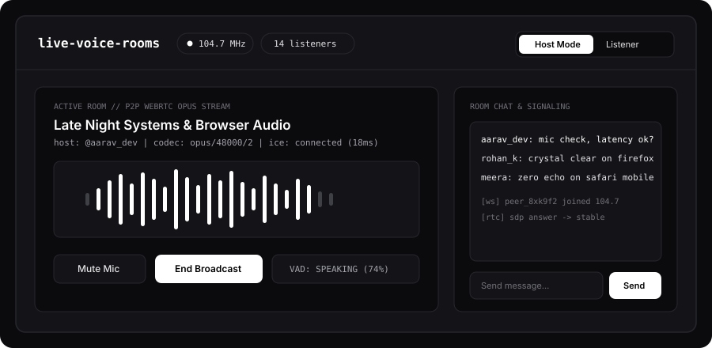

# live-voice-rooms


One click browser WebRTC voice rooms with a tiny Node.js WebSocket server.

Big cloud audio SDKs charge per minute just so one host can talk to 15 friends. I built this at 2am with adrak chai because clean 200 line jugaad > 50MB npm packages. If Chrome audio ever acted weird before, do not worry bhai, we fixed the classic Chromium clock drift quirk too.



## What it does

- Streams live mic audio from one host to many browser listeners over WebRTC.
- Animates live voice bars only when someone actually speaks.
- Holds the room open for 35 seconds if the host refreshes or switches WiFi.
- Includes live room chat and a speaker hand raise queue in the same socket.

## Run it in 60 seconds

```bash
git clone https://github.com/LevCodeLab/live-voice-rooms.git
cd live-voice-rooms
npm install

# Terminal 1: start signaling server on port 3000
npm run dev:server

# Terminal 2: start React UI on port 5173
npm run dev:web
```

Open two tabs at `http://localhost:5173`. Click **Go On Air** in Tab 1. Switch Tab 2 to **Listener Mode** and click **Tune In**.

Run tests anytime:

```bash
npm test
```

## Which file to edit

| File | What to change here |
| :--- | :--- |
| `src/services/signalingServer.js` | Edit WebSocket rooms, chat, and host reconnect timer |
| `src/services/webrtcConfig.js` | Change STUN or TURN server URLs |
| `src/hooks/useLiveAudioBroadcast.js` | Edit host mic capture and WebRTC offer logic |
| `src/hooks/useLiveAudioListener.js` | Edit listener audio playback and voice bars |
| `src/controllers/liveController.js` | Edit Express HTTP room endpoints |
| `src/App.jsx` | Edit the dark monochrome room UI |

## License

MIT License. Clone it, break it, ship it.
